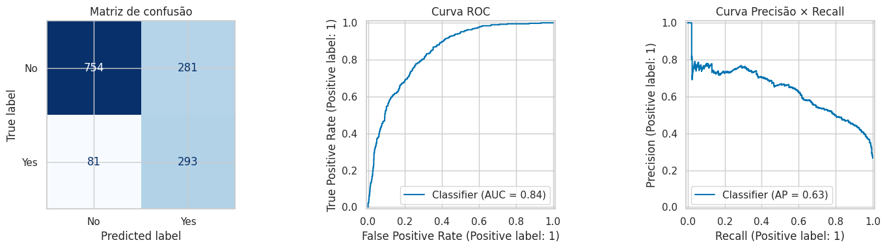
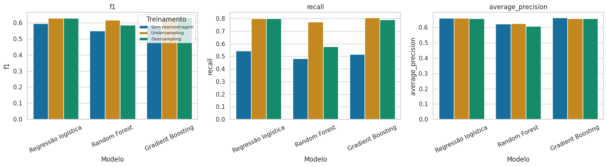

# Telco Customer Churn | Análise de Dados e Machine Learning

> Projeto de Ciência de Dados para investigar fatores associados ao cancelamento de clientes e comparar modelos de classificação, com foco em **interpretação estatística**, **avaliação rigorosa** e **aplicabilidade empresarial**.

**Contexto:** projeto acadêmico da disciplina *Introdução à Ciência de Dados*, ICMC — Universidade de São Paulo (USP).  
**Autor:** Welton Nunes Martin  
**Ferramentas:** Python · Pandas · NumPy · Matplotlib · Seaborn · SciPy · Statsmodels · Scikit-learn · Imbalanced-learn · Jupyter Notebook

## O problema

O cancelamento de clientes (*churn*) pode comprometer a receita e aumentar os custos de aquisição. O objetivo foi entender quais características estão associadas ao churn e construir modelos capazes de **priorizar clientes com maior risco previsto**.

O conjunto **Telco Customer Churn** contém **7.043 registros** e 21 colunas. A variável resposta é `Churn` (`Yes`/`No`), com cerca de **26,5%** de cancelamentos. Fonte pública: [Telco Customer Churn no Kaggle](https://www.kaggle.com/datasets/blastchar/telco-customer-churn).

## Abordagem

1. Auditoria dos dados: tipos, duplicatas, inconsistências e conversão de `TotalCharges`.
2. Separação estratificada **80% treino / 20% teste**, reservando o teste para a avaliação final.
3. Análise exploratória e testes estatísticos **somente no treinamento**.
4. Pré-processamento dentro de *pipelines*: imputação, padronização e *one-hot encoding*.
5. Comparação de **Regressão Logística, Random Forest e Gradient Boosting**, com validação cruzada estratificada.
6. Comparação de treinamento sem reamostragem, com *random undersampling* e com *random oversampling*.
7. Ajuste de hiperparâmetros por validação cruzada, estudo dos limiares e avaliação independente em teste.
8. Interpretação com coeficientes, VIF, importância por permutação e análise de **Recall@10%**.

## Principais resultados

**Modelo escolhido:** regressão logística com regularização L2, `C = 0.1`, `class_weight = 'balanced'` e limiar `0.50`. A seleção considerou o compromisso entre sensibilidade, desempenho e interpretabilidade; **não significa que o modelo seja superior em todas as métricas**.

| Métrica no teste independente | Resultado |
|---|---:|
| Acurácia | **74,31%** |
| Precisão (classe churn) | **51,05%** |
| Recall / sensibilidade | **78,34%** |
| F1-score | **61,81%** |
| ROC-AUC | **84,13%** |
| Average Precision | **63,44%** |

A matriz de confusão apresentou **293 verdadeiros positivos**, **81 falsos negativos**, **281 falsos positivos** e **754 verdadeiros negativos**.



### E se a empresa só pudesse contatar 10% dos clientes?

No conjunto de teste, os **141 clientes com maiores escores de risco** concentraram **108 dos 374 cancelamentos**, correspondendo a:

- **Recall@10%: 28,88%** dos cancelamentos identificados.
- **Lift@10%: 2,89×** em comparação à seleção aleatória.

Esse resultado mede capacidade de **priorização**, não quantos cancelamentos seriam efetivamente evitados.

### Balanceamento e seleção de modelos

As técnicas de subamostragem e sobreamostragem foram comparadas nos três algoritmos com os mesmos cinco folds. O **Gradient Boosting com oversampling** alcançou F1 médio de **0,6318** na comparação básica. Na busca adicional de hiperparâmetros, a **Random Forest** atingiu F1 de seleção de **0,6358**. Como essas pontuações são usadas para seleção, pequenas diferenças não permitem afirmar superioridade conclusiva de um algoritmo.



## Insights e implicações para o negócio

- **Tempo de permanência (`tenure`)** destacou-se como a variável mais importante na análise de permutação.
- **Tipo de contrato** e **serviço de internet** também apresentaram relevância para as previsões.
- `TotalCharges` mostrou dependência linear elevada com outras variáveis financeiras e de permanência; portanto, seus coeficientes exigem cautela interpretativa.
- Programas de fidelização, incentivos para contratos mais longos e ofertas personalizadas são **hipóteses de intervenção**, que precisam de testes controlados e análise de custo-benefício.

> **Limitação:** associações observacionais e previsões de churn não demonstram que oferecer descontos ou alongar contratos causará menor cancelamento. O modelo também deve ser monitorado e validado com novos dados antes de uso operacional.

## Como reproduzir

**Opção A — Google Colab**

1. Abra o notebook [`telco_customer_churn.ipynb`](telco_customer_churn.ipynb) no Google Colab.
2. Execute a célula de instalação `%pip install -q imbalanced-learn` se a biblioteca não estiver disponível no ambiente (é necessário descomentar a linha no notebook).
3. Rode as células em ordem. Quando solicitado, envie o arquivo `WA_Fn-UseC_-Telco-Customer-Churn.csv` incluído neste repositório.

**Opção B — Jupyter local**

Com Python instalado, na pasta do projeto:

```bash
python -m pip install -r requirements.txt
jupyter notebook telco_customer_churn.ipynb
```

O CSV já está na pasta esperada pelo código.

## Estrutura do repositório

```text
telco-customer-churn/
├── README.md
├── telco_customer_churn.ipynb
├── WA_Fn-UseC_-Telco-Customer-Churn.csv
├── requirements.txt
├── .gitignore
└── assets/
    ├── avaliacao_modelo.png
    └── comparacao_balanceamento.png
```

## Próximos passos

- Calibrar probabilidades previstas e estudar limiares baseados nos custos das intervenções.
- Avaliar a generalização com dados de outros períodos e monitorar *data drift*.
- Planejar testes A/B para avaliar intervenções de retenção de maneira causal.

---

**Observação:** desenvolvido para fins educacionais e de portfólio com dados públicos de demonstração. Não representa resultados de uma operadora real identificada.
